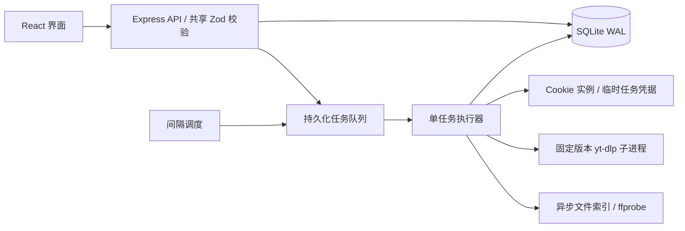

# 架构与边界

- `app.ts` 只负责请求、输入校验、资源变更和排队，不在请求中提取合集/视频元数据。
- `engine.ts` 管理调度、任务状态、snapshot、排除规则与执行流程。
- `downloader.ts` 封装 Cookie 解析/验证、最高格式选择、下载与成品检查。
- `process.ts` 统一无 shell 子进程执行、输出限额、超时、取消和错误脱敏。Windows 取消使用进程树终止，Unix 使用进程组终止。
- `store.ts` 提供参数化 SQLite 存取和事务，持久化配置、凭据元信息、快照、任务与完成凭证。
- `shared/contracts.ts` 给客户端类型约束，给服务端运行时输入校验。

## 快照与运行一致性

打开页面只读取存储的配置和快照；diff 每页最多 200 条，界面默认 100 条。标题/BV 搜索有防抖，筛选和选中状态由 React 管理。后台轮询不会重建输入框或抢走焦点。

合集刷新直接按页读取 Bilibili seasons_archives_list（每页最多 100 条），保留列表已有的标题和 pubdate；其他列表仍使用 yt-dlp flat-playlist。同步执行异步文件索引，不进行逐条详情、格式提取或媒体探测。分页总数、页大小与 BV 唯一性通过检查后才发布新快照；空合集、分页不完整和提取错误不覆盖旧快照。发布日期按 UTC 转换，与 yt-dlp upload_date 保持一致，不用 ctime 代替；列表缺失日期时仍在下载预检中核验。

人工下载请求携带 snapshot ID。过期快照、已被排除的所选项会返回冲突；配置运行中不能改来源、路径、凭据或删除。排除项允许运行时修改，并在每条视频及其预检后再次读取；已经开始传输的当前条目不会因新增排除而自动中断，可使用任务取消。

## 下载质量与失败语义

每条视频单独预检，按当前登录态下的 `bestvideo+bestaudio` 获取最高可用格式，然后将选中的视频/音频 ID 固定给下载进程，不加 1080p 硬限制。元数据查询后、下载前、下载完成后及下载异常后检查登录态；Cookie 错误终止整份配置的任务。

格式提取、下载或尺寸校验的单条错误记入 failures，并继续后续条目。低画质的同 BV 中转文件保留供人工处理，不覆盖、不当作已完成。新下载经 ffprobe 核验尺寸后才记录完成凭证；分片和临时文件不进入已完成索引。

`queued → running → completed / partial / failed / cancelled`。进程重启后，先前的 queued/running 变为 interrupted。配置的 next_run 存在数据库中；到期后补一次刷新，之后按间隔重新计时。

## 安全和部署边界

本机模式限制 Host，写接口要求专用请求头并校验 Origin；无开放 CORS。远程模式所有 API 都需令牌，外部 HTTPS 来源需显式配置。工具调用参数以数组传递，没有 shell 拼接。前端文本经 React 转义；错误信息不包含 Cookie 原文或 yt-dlp 原始 stderr。

目前是个人/单主机产品：无多用户权限模型，不负责跨设备文件系统映射、系统开机服务或公网证书配置。服务使用独立 PID 锁避免多个实例同时调度同一个数据库。Cookie 托管是本机文件存储，未声称提供静态加密。

新增内容平台时应增加独立的来源/鉴权适配器并扩展共享 schema；当前入口只接受 Bilibili 合集，不把任意 URL 交给提取器。新增多 worker 时需要把队列领取改成数据库事务锁，并为共享下载目录增加互斥，不能仅把串行执行改成 Promise.all。

## 媒体档案与封面

SQLite 新增以下表，旧 documents 配置/任务/快照继续保留，启动时幂等导入已有快照和下载凭证：

- media：内部作品 UUID，不与 BV 或 YouTube ID 绑定。
- media_sources：来源 UUID、media_id、platform、external_id、标题、URL、发布日期、封面 URL。UNIQUE(platform, external_id)，ID 保留大小写；同一作品可以关联多个来源，不按标题自动合并。
- media_collections：配置与来源的多对多关系，present 标记当前是否仍在来源列表；源移除不删除媒体档案。
- media_files：来源与本地文件路径关系，保存下载核验 metadata；同一来源可以对应多个文件。
- media_covers：按来源保存图片 BLOB、MIME、原 URL 和更新时间。图片独立于快照，可在凭据失效、断网时继续通过受鉴权保护的 API 读取。

后台串行缓存封面，不阻塞快照发布，不带 Cookie；限定公开图片 CDN、禁用重定向、限制单图 4 MB、检查图片签名。失败保留旧图片，下次启动或刷新重试。浏览器在图片接近视口时读取本地封面，没有缓存时暂用原 URL。

新下载传入 --write-thumbnail、--embed-thumbnail、--embed-metadata：封面独立文件保留在下载目录，并嵌入视频。已有视频不会因升级自动重封装。数据库已为多平台扩展留出来源与作品分层；当前配置入口和下载流程仍只支持 Bilibili，尚未新增 YouTube 下载支持。

备份时请使用 SQLite backup API，或停止服务后复制完整 state 目录；不要在运行时只复制主数据库文件而忽略 WAL。
