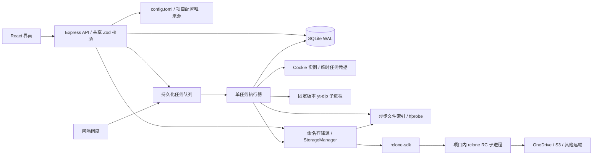

# 架构与边界

- `app.ts` 只负责请求、输入校验、资源变更和排队，不在请求中提取合集/视频元数据。
- `engine.ts` 管理调度、任务状态、snapshot、排除规则与执行流程。
- `downloader.ts` 封装 Cookie 解析/验证、最高格式选择、下载与成品检查。
- `process.ts` 统一无 shell 子进程执行、输出限额、超时、取消和错误脱敏。Windows 取消使用进程树终止，Unix 使用进程组终止。
- `config-file.ts` 校验、加载和原子发布版本化的 TOML 项目配置；保存前比较文件内容，阻止覆盖服务运行期间的外部修改。配置文件不通过 API 返回。
- `store.ts` 将全局设置、合集与排除规则、Cookie 定义/导入内容、存储源路由到 TOML，SQLite 仅持久化运行状态、快照、任务与完成凭证。界面仍使用相同资源 API，读取时组合配置与运行状态，不回显 Cookie 原文。嵌套事务在最外层一次发布文件，发布失败回滚本次 SQLite 变更；文件先发布再提交数据库，崩溃后以配置文件为准并重新检查缓存指纹。
- `storage.ts` 管理名字到本地/云端位置的映射、旧路径迁移、远端索引、存档、取回和删除；配置通过 `storage_name` 引用。
- RC 的本地文件操作使用局部 `:local,encoding=Raw:` 保留原生全角标点（例如 Windows 文件名中的 `？`），远端继续使用用户的 encoding。已有副本同时按文件名/BV 检查并保留原路径。取回在临时目录保留本机兼容的原名；远端暴露的 Windows 非法半角字符由本地默认 encoding 转换，再校验、独占发布。
- `rclone-client.ts` 使用开源 `rclone-sdk` 调用 RC API，管理项目内固定版本 rclone 的进程生命周期，将异步 job 与任务取消/进度连接。全局文件锁避免与下载、修改配置交错；每次 RC 调用使用独立 stats group，结束后释放。
- 云端失败保留 RC 提交响应、job/status 错误或启动错误中的原因，附带失败阶段；`storage-errors.ts` 只提取已知诊断字段，并隐藏配置凭据、鉴权头及 URL 查询参数。`TaskError.details` 经任务/单条 failures 持久化，也用于直接 API 错误响应；界面失败任务默认展开详情。历史记录没有保存的原始错误无法重建。
- `media-layout.ts` 按发布日期生成白名单内的存档子目录。中转文件保持原位置，存档到本地/云端时才应用规则；日期未知平铺。本地逐级创建普通目录，拒绝符号链接与路径越界；同名检查仍扫描整个存储源，以保留旧位置的重复文件保护。
- `POST /api/storage-config` 接收完整 rclone 配置文本，先用独立的项目内 RC 子进程解析、检查远端与类型，再关闭现有子进程并原子替换托管文件。导入切换到托管配置并使云端快照及校验记录失效；外部配置文件和已有视频保持不变。`GET /api/storage-config` 仅返回远端名，配置与令牌不进入 API 响应。
- `shared/contracts.ts` 给客户端类型约束，给服务端运行时输入校验。

## 快照与运行一致性

项目配置默认为 `state/config.toml`，可用 `BACKUP_CONFIG_FILE` 将其与运行目录分开。首次升级在原配置仍完整保留时发布 TOML，成功后才移除 SQLite 配置行。上传的 Cookie 原文嵌入 TOML，执行副本按内容指纹写入运行目录；验证状态与下次执行时间单独留在 SQLite，日常任务不会改写 TOML。相对路径以 TOML 所在目录为基准。

手动编辑在重启后加载；来源、凭据或有效路径变化通过配置指纹使相关旧快照失效，仅改合集显示名称继续保留快照。新数据库会重新建立计划和 Cookie 执行副本，无需携带快照、封面或任务历史。引用外部 Cookie 文件和浏览器登录态仍需在新主机自行准备。

打开页面只读取存储的配置和快照；diff 每页最多 200 条，界面默认 100 条。标题/BV 搜索有防抖，筛选和选中状态由 React 管理。后台轮询不会重建输入框或抢走焦点。

合集刷新直接按页读取 Bilibili seasons_archives_list（每页最多 100 条），保留列表已有的标题和 pubdate；其他列表仍使用 yt-dlp flat-playlist。同步执行异步文件索引，不进行逐条详情、格式提取或媒体探测。分页总数、页大小与 BV 唯一性通过检查后才发布新快照；空合集、分页不完整和提取错误不覆盖旧快照。发布日期按 UTC 转换，与 yt-dlp upload_date 保持一致，不用 ctime 代替；列表缺失日期时仍在下载预检中核验。

人工下载请求携带 snapshot ID。过期快照、已被排除的所选项会返回冲突；配置运行中不能改来源、路径、凭据或删除。排除项允许运行时修改，并在每条视频及其预检后再次读取；已经开始传输的当前条目不会因新增排除而自动中断，可使用任务取消。

## 下载质量与失败语义

每条视频单独预检，按当前登录态下的 `bestvideo+bestaudio` 获取最高可用格式，然后将选中的视频/音频 ID 固定给下载进程，不加 1080p 硬限制。元数据查询后、下载前、下载完成后及下载异常后检查登录态；Cookie 错误终止整份配置的任务。

格式提取、下载或尺寸校验的单条错误记入 failures，并继续后续条目。低画质的同 BV 中转文件保留供人工处理，不覆盖、不当作已完成。新下载经 ffprobe 核验尺寸后才记录完成凭证；分片和临时文件不进入已完成索引。

`queued → running → completed / partial / failed / cancelled`。进程重启后，先前的 queued/running 变为 interrupted。配置的 next_run 存在数据库中；到期后补一次刷新，之后按间隔重新计时。

## 安全和部署边界

本机模式限制 Host，写接口要求专用请求头并校验 Origin；无开放 CORS。远程模式所有 API 都需令牌，外部 HTTPS 来源需显式配置。工具调用参数以数组传递，没有 shell 拼接。前端文本经 React 转义；错误信息不包含 Cookie 原文或 yt-dlp 原始 stderr。

目前是个人/单主机产品：无多用户权限模型，不负责跨设备文件系统映射、系统开机服务或公网证书配置。服务使用独立 PID 锁避免多个实例同时调度同一个数据库。Cookie 托管是本机文件存储，未声称提供静态加密。

新增内容平台时应增加独立的来源/鉴权适配器并扩展共享 schema；当前入口只接受 Bilibili 合集，不把任意 URL 交给提取器。新增多 worker 时需要把队列领取改成数据库事务锁，并为共享下载目录增加互斥，不能仅把串行执行改成 Promise.all。

## 媒体档案与封面

SQLite 包含以下表，documents 保留任务/快照/完成凭证，启动时幂等导入已有快照和下载凭证；旧配置在 TOML 成功发布后移出数据库：

- media：内部作品 UUID，不与 BV 或 YouTube ID 绑定。
- media_sources：来源 UUID、media_id、platform、external_id、标题、URL、发布日期、封面 URL。UNIQUE(platform, external_id)，ID 保留大小写；同一作品可以关联多个来源，不按标题自动合并。
- media_collections：配置与来源的多对多关系，present 标记当前是否仍在来源列表；源移除不删除媒体档案。
- media_files：来源与文件位置关系（本地路径或 rclone 远端路径），保存下载核验 metadata；同一来源可以对应多个文件。打开时只接受当前配置根目录内的真实本地路径。
- media_covers：按来源保存图片 BLOB、MIME、原 URL 和更新时间。图片独立于快照，可在凭据失效、断网时继续通过受鉴权保护的 API 读取。

后台串行缓存封面，不阻塞快照发布，不带 Cookie；限定公开图片 CDN、禁用重定向、限制单图 4 MB、检查图片签名。失败保留旧图片，下次启动或刷新重试。浏览器在图片接近视口时读取本地封面，没有缓存时暂用原 URL。

新下载传入 --write-thumbnail、--embed-thumbnail、--embed-metadata：封面独立文件保留在下载目录，并嵌入视频。已有视频不会因升级自动重封装。数据库已为多平台扩展留出来源与作品分层；当前配置入口和下载流程仍只支持 Bilibili，尚未新增 YouTube 下载支持。

备份时请使用 SQLite backup API，或停止服务后复制完整 state 目录；不要在运行时只复制主数据库文件而忽略 WAL。

`documents` 增加 `storages`（唯一名称、类型、根路径）和 `cloud_receipts`（存储源 ID/BV、已校验远端位置、SHA-256）。云端副本读取失败不会发布新的空索引；对已有同名远端先比较内容，禁止覆盖。上传后完整读取云端计算 SHA-256，本地文件身份/内容再次核验后才能删除；取回使用临时目录和不覆盖的发布操作。云端完成凭证在清理本地前持久化，服务重启后可重新扫描、确认重复副本并重试。
